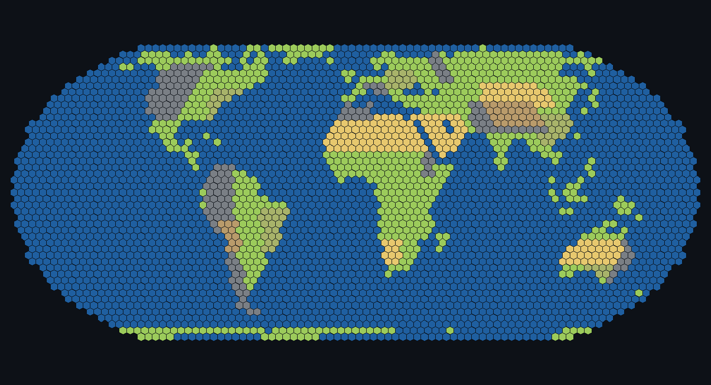

# 地球比例六角地图：Equal Earth → simos 导入试验

> **日期**：2026-11-14
> **状态**：试验报告（不是生产世界登记；生成物在 `run/earth-globe/`，已被 `.gitignore` 忽略）
> **分支**：`feature/d036-node-editor`



## 1. 结论

可以做。当前 simos 是 **pointy-top 轴向六角格 + 平面地图**，没有球面坐标；直接在普通经纬矩形上铺格子会让高纬度格子在球面上被压扁。试验采用：

```text
Natural Earth 110m land
  → Equal Earth 等面积投影
  → 规则 pointy-top 六角格（每个投影格等面积）
  → GSim root full map + regen samples
  → tools/gsimap_import.py --regen-samples
  → simos store / WebUI
```

所以地图上的**每个六角格在球面上面积相同**，海陆比例和大陆形状保留；但这不是严格的球体拓扑（见 §5）。

## 2. 试验结果

| 项 | 结果 |
|---|---|
| 目标格数 | 4000 |
| 实际格数 | **3965** |
| 陆地 / 海洋 | **1096 (27.64%) / 2869 (72.36%)** |
| 地形 | ocean 2869 / plains 660 / desert 168 / low_hills 66 / mountains 163 / plateau 39 |
| 区域 | 8 个大陆分组（africa / europe / asia / north-america / south-america / australia / antarctica / other） |
| 地形块 | 62 块，覆盖全部 3965 格 |
| 高度范围 | 0.12–0.82（无 clamp） |
| 导入模块 | 当前 10 个 codec：actor/army/culture/economy/ga/gov/map/production/social/unit |

Natural Earth 110m 是粗略海岸线；陆地比例比真实 29.2% 略低（27.64%），主要来自六角中心采样和 110m 数据分辨率。

## 3. 实际走过的导入链

```bash
# 1) 取 Natural Earth 陆地（公共领域数据）
curl -L -sS \
  https://raw.githubusercontent.com/nvkelso/natural-earth-vector/master/geojson/ne_110m_land.geojson \
  -o run/earth-globe/ne_110m_land.geojson

# 2) 生成 GSim root full map + regen samples
python3 tools/build_earth_hex_map.py \
  run/earth-globe/ne_110m_land.geojson \
  run/earth-globe/earth-map.json \
  --samples run/earth-globe/earth-samples.json \
  --preview run/earth-globe/earth-preview.png \
  --target-hexes 4000

# 3) 导入成 simos store（补齐当前 10 模块空切片）
python3 tools/gsimap_import.py \
  run/earth-globe/earth-map.json \
  run/earth-globe/import \
  --regen-samples run/earth-globe/earth-samples.json \
  --report-json run/earth-globe/report.json

# 4) 用 editor profile 起壳（非空库不会重新 seed）
tools/run-shaded.sh simos-app/target/simos-app-0.1.0-SNAPSHOT-shaded.jar \
  --config run/earth-globe/shell.json --profile editor
```

启动后 `GET /api/map/overview` 返回：

```text
mapId=earth-globe  hexCount=3965  blocks=62  regions=8
```

## 4. 真实编辑验证

在导入后的 Earth store 上，用 Chrome 打开 `http://127.0.0.1:5821/`，进入地图编辑，选 `low_hills`，对北美格 `(-8,-23)` 右键刷：

```text
status = 已改 1 格为 low_hills（一条命令，已写入当前节点）
revision = 1（同 tick 原地更新）
writeEpoch 0 → 1
GET /api/map/hex?q=-8&r=-23 → low_hills
```

说明导入地图不是“只能看”的静态快照，仍走 D-036 的 `map.SetTerrain` 写链；同 tick 写代次让 WebUI 立即重载。

## 5. 本次顺带修好的导入兼容问题

`tools/gsimap_import.py` 原本是旧世界线格式；在 current HEAD 上直接导入会失败：

1. 当前 `HexCell` 是 `{height, land}`，但重建模式只写 `{height}` ⇒ `HexCell.land 不得为 null`；
2. 空切片仍用旧 namespace `sd`、旧 `EconomyData.classFirst`、旧 `SocialData` 缺 `provisioning` ⇒ replay 解码失败；
3. 当前 Shell 有 10 个 codec，旧导入器只补 8 个空切片。

已修：

- 重建模式逐格写 `"land": {"byType": {}}`；
- 用当前 codec 生成的 9 个空模块载荷替换旧载荷（map 由 importer 自己产出）；
- 空切片键集覆盖当前 10 modules。

## 6. 限制与下一步

- **是球面等面积投影，不是球体拓扑**：地图是平面椭圆，左右经线不自动接合；这是当前 `axial (q,r)` 地图模型的边界。
- 要做真正的“地球仪六角格”，需要 **Goldberg / 二十面体球面六角化**（12 个五边形缺陷）或给地图增加经度环绕/接缝语义；这会改地图拓扑和邻接，不是 importer 局部修补。
- 当前高纬陆地的形状由等面积投影保留，但水陆边界仍受 110m 数据与六角中心采样影响。
- 本次没有生成城市/单位/人口；只验证地图/区域/编辑链。若作为正式世界，需要单独裁定世界登记、城市落点、单位出生地与区域命名。

## 7. 本机生成物

```text
run/earth-globe/ne_110m_land.geojson
run/earth-globe/earth-map2.json
run/earth-globe/earth-samples2.json
run/earth-globe/earth-preview2.png
run/earth-globe/import6/            # simos store
run/earth-globe/report6.json
run/earth-globe/shell6.json
```

以上都在 `run/` 下，不进入版本库；生成器和 importer 修复已入库。
