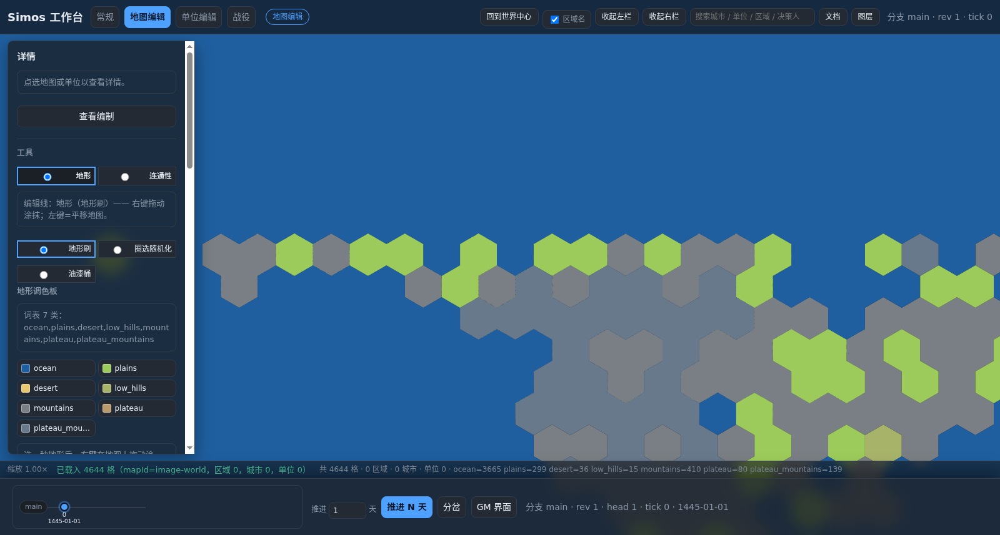

# 图片底图空白世界与自动六角网格导入

> **日期**：2026-11-14
> **分支**：`image-world-import`
> **状态**：可用原型（独立 worktree；原圆柱面 WIP 留在主工作树，未混入本分支）

## 1. 可行，已经走通



新增世界 **`image-world`**：

- 空地图（0 hex），但保留 7 类地形词表和当前 10 个模块空切片；
- 在 WebUI 地图编辑模式载入 PNG 底图；
- 输入“网格列数”，自动生成 pointy-top 六角网格并按每格中心取色映射到最近地形；
- 一条 `map.ImportHexGrid` 命令原子建立整张地图；
- 不需要额外连通性/环绕语义，网格是普通平面地图。

实测：1400×760 底图、86 列 ⇒ **4644 hex**；命令成功，状态显示“已生成 4644 格”，`writeEpoch` 从 1 到 2。

## 2. 新增接口

### `map.ImportHexGrid`

载荷：

```json
{
  "hexes": [
    {"q": 0, "r": 0, "terrain": "plains"},
    {"q": 1, "r": 0, "terrain": "ocean"}
  ]
}
```

语义：

- 只在**空白地图**上可执行；非空地图具名拒绝；
- 校验坐标唯一、地形在 `TerrainCatalog` 内；
- 高度取地形代表高度，地形块按同地形六邻连通分量切分；
- 通过 `MapChangeSet` 提交，不绕过 `Command → ChangeSet → Revision`。

### 新世界

```text
WorldRegistry.IMAGE_WORLD = image-world
```

空库启动：

```bash
tools/run-shaded.sh <shaded.jar> \
  --config run/image-world.json --profile editor
```

## 3. 前端操作

1. 打开地图编辑；
2. 在 PNG 底图面板选择图片；
3. 填“自动生成网格列数”（默认 86）；
4. 点“从底图生成六角网格”。

颜色映射沿用现有 PNG 取色规则：最近地形颜色 + 阈值；无法匹配/透明像素按海洋兜底。

## 4. 实测故障与修复：生成成功但界面空白

用户实测：导入 PNG → 点“从底图生成六角网格” → 界面提示已生成，但地图没有任何变化；刷新后仍然空白。

根因不是网格或渲染，而是 **editor 同 tick 原地写入的读缓存竞态**：

1. 同 tick 合并路径先更新 revision，并在 `Timeline.updateRevision(...)` 里推进 `writeEpoch`；
2. 随后才用候选态覆盖该节点的 checkpoint；
3. 读线程若恰好落在两步之间，会看到“新代次 + 旧 checkpoint”，把旧态按新代次写入 `QueryService` 的 revision 缓存；
4. 同 tick 合并不会推进 revision，之后 `writeEpoch` 也不再变化 ⇒ 缓存永久不失效，直到重启进程。

所以命令已经成功、checkpoint 最终也已有完整地图，但 GUI 读口一直返回旧态（0 格）；刷新页面只能清浏览器状态，清不掉服务端缓存。

修复（`e4d6139a`）：

- `Timeline.updateRevision(...)` 不再自行推进 `writeEpoch`；
- `CommandBus` 在候选态 checkpoint 写完后再调用 `Timeline.bumpWriteEpoch()`（`finally` 保证异常路径也会推进）；
- 新增 `CommandBusSameTickMergeTest`，直接断言 checkpoint 写入期间仍是旧代次、写完才 +1；
- 补齐 `AdjudicateTickToolTest` 对 `map.ImportHexGrid` 的目标声明样本。

修复后实测：

- 32 线程并发请求 `/api/map/overview`，同时导入 4558 格：命令返回后最终读口和连续 5 次复查均为 **4558**；
- Playwright 真浏览器：空白 world → 上传 900×500 PNG → 30 列生成 **600 格** → 生成后地图立即显示 600 格 → 刷新后仍显示 600 格；
- 聚焦测试：`CommandBusSameTickMergeTest` 1/1、`ShellAssemblySmokeTest` 3/3、`QueryServiceTest` 17/17、`AdjudicateTickToolTest` 16/16、`simos-core` 全测 249/249；
- frontend gate：430/430。

## 5. 已知边界

- 底图只在当前编辑会话中使用，不随节点持久化；生成后的地形/网格已写入 world store。刷新后底图需要重新载入，但地图数据保留。
- 网格是矩形自动裁取，不额外生成区域/城市/单位。
- 目前没有“清空当前网格再重生成”；重新导入请新建一个空 world/store。
- 不涉及圆柱面 wrap（原 WIP 保留在主工作树，未合入本分支）。

## 6. 验证

- `ImportHexGridHandlerTest`：3 tests PASS；
- `McpCoverageTest + SimosToolsTest`：66 tests PASS（补齐新 handler 的 catalog/命令计数）；
- 前端门禁：**430/430 PASS**；
- 真实 WebUI：空白 world → 上传 PNG → 生成 4644 格，成功；
- 竞态修复后真实 WebUI：生成 600 格后立即显示，刷新后仍为 600 格；
- full gate：功能改动前/中多次被打断，本分支尚未拿到一次完整的 full gate 结论，因此不写成 full gate PASS。

## 7. 本机产物

```text
run/image-world/                 # 空白世界 store（测试时生成过网格；交付前重置）
run/image-world-server.log
run/image-world-grid.png         # 生成后的 WebUI 截图
```
